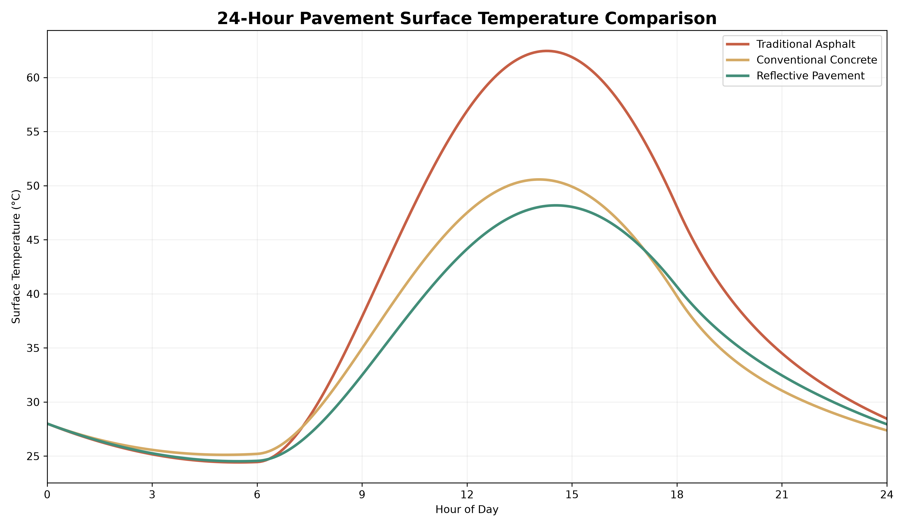
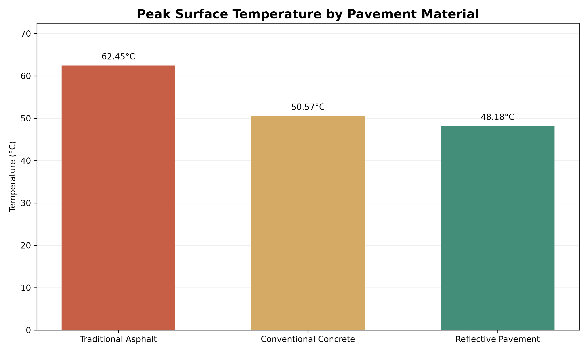

# Beyond Blacktop

### Rethinking the Surfaces Beneath Our Cities

A computational materials science investigation of pavement thermal properties, alternative paving materials, and the urban heat island effect.


**Developer:** Ava Williams

**Live Application:** [Beyond Blacktop](https://beyond-blacktop.streamlit.app/)

---

## Abstract

Urban infrastructure plays a significant role in the absorption, storage, and redistribution of thermal energy. Traditional asphalt absorbs a substantial proportion of incoming solar radiation, contributing to elevated surface temperatures in urban environments.

Beyond Blacktop is a computational investigation into how alternative pavement materials may reduce surface heat accumulation. Using a simplified thermal energy balance model and numerical integration, this project simulates the surface temperatures of three pavement materials over a hypothetical 24-hour summer day in Houston, Texas.

The project also incorporates a controlled sensitivity analysis to investigate the relationship between surface albedo and thermal performance.

## Motivation

My interests lie at the intersection of materials science, engineering, environmental epidemiology, and social equity.

Extreme urban heat raises questions about how infrastructure decisions influence environmental conditions, particularly in historically underserved communities. I wanted to explore whether modifying the physical properties of everyday infrastructure could help mitigate urban heat.

Beyond Blacktop represents an initial computational exploration of this question.

## Research Questions

1. How do different pavement materials influence surface temperature throughout a daily heating and cooling cycle?
2. How does increasing surface albedo affect maximum and average pavement temperatures?
3. How do thermal properties influence the timing and magnitude of peak surface temperatures?
4. What potential role could alternative paving materials play in urban heat mitigation?

## Materials Investigated

| Property | Asphalt | Concrete | Reflective Pavement |
|---|---:|---:|---:|
| Albedo | 0.08 | 0.30 | 0.50 |
| Emissivity | 0.95 | 0.90 | 0.90 |
| Density (kg/m³) | 2300 | 2400 | 2300 |
| Specific Heat (J/kg·K) | 920 | 880 | 920 |
| Thermal Conductivity (W/m·K) | 0.75 | 1.40 | 0.75 |

These values are preliminary modeling assumptions rather than experimentally measured material properties.

## Scientific Methodology

The simulation uses a simplified surface energy balance incorporating four primary heat transfer mechanisms:

- Solar radiation absorption
- Longwave thermal radiation
- Convective heat transfer
- Conductive heat transfer

### Solar Absorption

$$
Q_{solar} = (1-\alpha)G
$$

Where alpha represents surface albedo and G represents incoming solar irradiance.

### Thermal Radiation

$$
Q_{rad} = \epsilon\sigma(T_s^4-T_{sky}^4)
$$

Temperatures in this equation are expressed in Kelvin.

### Convection

$$
Q_{conv} = h(T_s-T_{air})
$$

### Conduction

$$
Q_{cond} = \frac{k(T_s-T_{ground})}{d}
$$

### Net Energy Balance

$$
Q_{net}=Q_{solar}-Q_{rad}-Q_{conv}-Q_{cond}
$$

### Temperature Change

$$
\frac{dT_s}{dt}=\frac{Q_{net}}{\rho c_p d}
$$

The resulting ordinary differential equation is solved using SciPy's adaptive Runge-Kutta RK45 numerical integration method.

## Environmental Assumptions

The simulation represents a hypothetical summer day in Houston, Texas.

| Parameter | Assumed Value |
|---|---|
| Maximum Solar Irradiance | 1000 W/m² |
| Maximum Air Temperature | 37°C |
| Minimum Air Temperature | 25°C |
| Initial Pavement Temperature | 28°C |
| Ground Temperature | 28°C |
| Pavement Thickness | 0.10 m |
| Convective Heat Transfer Coefficient | 10 W/m²·K |
| Simulation Duration | 24 hours |
| Output Interval | 5 minutes |

Solar irradiance and ambient air temperature are modeled using sinusoidal functions. These environmental conditions are synthetic and are not historical weather observations.

## Simulation Results

The baseline simulation produced the following results:

| Material | Maximum | Minimum | Average | Daily Range |
|---|---:|---:|---:|---:|
| Traditional Asphalt | 62.45°C | 24.42°C | 39.61°C | 38.04°C |
| Conventional Concrete | 50.57°C | 25.11°C | 35.18°C | 25.46°C |
| Reflective Pavement | 48.18°C | 24.52°C | 34.43°C | 23.66°C |

### Daily Temperature Comparison



### Peak Temperature Comparison



### Key Observations

- Reflective pavement achieved a modeled peak surface temperature approximately 14.28°C lower than traditional asphalt.
- All three materials exhibited thermal lag, reaching their maximum surface temperatures after peak solar irradiance.
- Traditional asphalt exhibited the largest daily temperature range.
- Concrete and reflective pavement displayed different evening cooling behavior, suggesting that thermal performance depends on multiple material properties rather than albedo alone.

These findings are specific to the assumptions and environmental conditions used in the model.

## Sensitivity Analysis

A controlled computational experiment was conducted to investigate the effect of albedo on pavement temperature.

### Experimental Design

- Independent variable: Surface albedo
- Dependent variables: Maximum and average surface temperature
- Baseline material: Traditional asphalt
- Number of simulations: 21
- Albedo range: 0.00 to 1.00
- Increment: 0.05

All remaining material properties and environmental conditions were held constant.

Python's immutable dataclasses and the dataclasses.replace() function were used to generate modified material objects without altering the original baseline material.

The simulation exhibited a nearly linear inverse relationship between albedo and peak surface temperature over the investigated range.

The endpoints of the albedo range represent theoretical limiting cases and do not necessarily correspond to commercially available pavement materials.

## Interactive Dashboard

The Streamlit application allows users to:

- Compare three pavement materials.
- Modify the initial pavement temperature.
- Visualize 24-hour thermal behavior.
- Compare pavement and ambient air temperatures.
- Examine maximum, minimum, and average temperatures.
- Explore the effects of albedo through sensitivity analysis.
- Download simulation results as CSV files.
- Review the scientific methodology and model limitations.

[Launch the Interactive Dashboard](https://beyond-blacktop.streamlit.app/)

## Technical Implementation

### Programming Language

Python

### Libraries

- NumPy: Numerical operations and array manipulation
- SciPy: Ordinary differential equation integration
- Matplotlib: Scientific visualization
- Pandas: Structured data analysis and CSV export
- Streamlit: Interactive application development
- Dataclasses: Immutable material property objects

### Programming Concepts

- Object-oriented programming
- Modular software architecture
- Immutable data structures
- Numerical integration
- Scientific computing
- Differential equation modeling
- Parameter sweeps
- Data visualization
- Error handling
- Interactive application development

## Project Structure

| File | Purpose |
|---|---|
| main.py | Initial solar absorption calculator |
| materials.py | Material property database |
| simulation.py | Thermal energy balance calculations |
| environment.py | Daily environmental conditions |
| solver.py | Numerical differential equation solver |
| visualization.py | Scientific graph generation |
| sensitivity.py | Albedo sensitivity analysis |
| app.py | Interactive Streamlit dashboard |
| requirements.txt | Python dependencies |
| .streamlit/config.toml | Application appearance settings |

## Installation and Execution

Clone the repository:

```bash
git clone https://github.com/avareneewilliams09-code/beyond-blacktop.git
cd beyond-blacktop
```

Install the required libraries in a Python virtual environment:

```bash
python -m venv .venv
```

Activate the environment on Windows:

```bash
.venv\Scripts\activate
```

Or on macOS/Linux:

```bash
source .venv/bin/activate
```

Install dependencies:

```bash
python -m pip install -r requirements.txt
```

Run the numerical simulation:

```bash
python solver.py
```

Generate scientific visualizations:

```bash
python visualization.py
```

Execute the sensitivity analysis:

```bash
python sensitivity.py
```

Launch the interactive application:

```bash
python -m streamlit run app.py
```

## Verification and Debugging

Individual components were manually checked during development, including:

- Solar energy absorption calculations
- Volumetric heat capacity calculations
- Net surface energy flux
- Temperature change rate
- Maximum temperature identification
- Daily temperature range calculations
- Comparative peak temperature calculations
- Scientific graph generation
- Streamlit application deployment

These checks establish preliminary computational consistency but do not constitute experimental validation.

## Model Limitations

This project uses a simplified computational model and has several limitations:

- Material properties are preliminary assumptions.
- Weather conditions are synthetic.
- The pavement is represented as a simplified uniform thermal layer.
- Ground temperature and convection coefficients are assumed constant.
- Evaporative cooling is not incorporated.
- Shading, traffic, precipitation, and variable wind conditions are excluded.
- The model has not been validated against experimental field measurements.
- Surface temperature reductions do not necessarily translate directly into equivalent air temperature reductions or improved pedestrian thermal comfort.

The model should be interpreted as an exploratory computational investigation rather than a predictive engineering tool.

## Future Research

Potential extensions of this project include:

- Incorporating measured Houston weather data.
- Validating simulated temperatures against field measurements.
- Developing a multilayer pavement heat transfer model.
- Investigating permeable pavement and evaporative cooling.
- Conducting sensitivity analyses of thermal conductivity and emissivity.
- Adding adjustable environmental parameters.
- Implementing automated unit tests and numerical convergence studies.
- Investigating relationships between pavement design, pedestrian heat exposure, and environmental health disparities.

## Background Reading

- [U.S. Environmental Protection Agency: Using Cool Pavements to Reduce Heat Islands](https://www.epa.gov/heatislands/using-cool-pavements-reduce-heat-islands)
- [Lawrence Berkeley National Laboratory: Heat Island Group](https://heatisland.lbl.gov/)
- [SciPy Documentation: solve_ivp](https://docs.scipy.org/doc/scipy/reference/generated/scipy.integrate.solve_ivp.html)
- [NumPy Documentation](https://numpy.org/doc/)
- [Streamlit Documentation](https://docs.streamlit.io/)

These resources provide relevant scientific and computational background. The material assumptions have not yet been calibrated against published experimental datasets.

## Development Contributions and AI Assistance

I developed this project through an iterative, AI-assisted learning process using ChatGPT as a programming and computational modeling mentor.

My contributions included implementing and modifying calculations, adding comparative numerical analysis, checking mathematical outputs, troubleshooting execution errors, generating visualizations, configuring dependencies, organizing the repository, and deploying the interactive application.

AI assistance included project planning, starter code, explanations of heat transfer equations and numerical methods, debugging guidance, dashboard implementation, sensitivity analysis scaffolding, and documentation drafting.

This project reflects my ongoing development of computational research skills rather than independently authored software in its entirety.

---

**Ava Williams**

Computational Research | Materials Science | Environmental Health

Beyond Blacktop explores how the materials beneath our feet may influence the environments in which we live.
